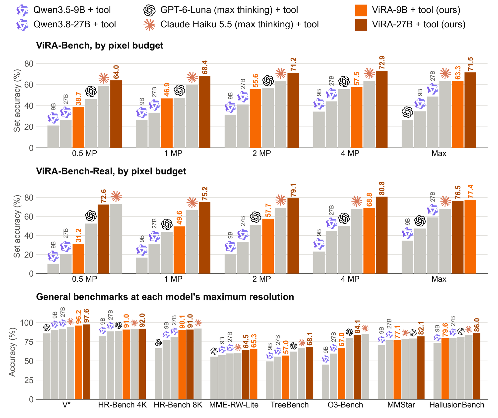

# ViRA: Toward Ultra-High-Resolution Visual Agents via Cross-Input Relative Policy Optimization

[](https://arxiv.org/abs/2611.21605)
[](https://github.com/huawei-lin/ViRA)
[](https://huggingface.co/huaweilin/ViRA-9B)
[](https://huggingface.co/huaweilin/ViRA-27B)
[](https://huggingface.co/datasets/huaweilin/ViRA-Bench)
[](https://huggingface.co/datasets/huaweilin/ViRA-Train)
[](https://huggingface.co/collections/huaweilin/vira)
[](LICENSE)



*Set accuracy on ViRA-Bench and ViRA-Bench-Real at five pixel budgets, and accuracy on general benchmarks at each model's maximum resolution. The bars of each group are sorted by height. Claude Haiku 5.5 and GPT-6-Luna run at their highest thinking level.*

This repository holds the code of the paper **["ViRA: Toward Ultra-High-Resolution Visual Agents via Cross-Input
Relative Policy Optimization"](https://arxiv.org/abs/2611.21605)**: training with CrossRPO, evaluation and inference of ViRA-9B and ViRA-27B.

## Abstract

Paper: [arXiv:2611.21605](https://arxiv.org/abs/2611.21605)

Visual agents answer questions about ultra-high-resolution photos by zooming into the relevant regions. However,
existing agents often answer from common sense instead of reading the evidence. Reinforcement learning (RL) on the
final answer cannot correct this, because a guess earns the same reward as reading. We propose Cross-Input Relative
Policy Optimization (CrossRPO), which trains agents on **contrast sets**. A contrast set asks one question about
several versions of an image that differ only in a small region with the evidence and have different answers, so only
reading the evidence solves the whole set. CrossRPO rewards solving the whole set, and we prove that it does not
reinforce a set answered from common sense. We build contrast sets for training (ViRA-Train) and evaluation
(ViRA-Bench) by editing one small object in images of 21 to 120 megapixels, and we photograph further sets with real
changes (ViRA-Bench-Real) to exclude editing traces. We train two Visual Reasoning Agents, ViRA-9B and ViRA-27B, with
CrossRPO on only about 3,500 items of ViRA-Train each. CrossRPO achieves 63.3% set accuracy on ViRA-Bench at the maximum
resolution, against 59.3% for GRPO. ViRA-9B is the most accurate open
model of its size on all benchmarks, and ViRA-27B outperforms Claude Haiku 5.5 and GPT-6-Luna, both at their highest
thinking level, on most benchmarks.

## Resources

| | |
|---|---|
| Paper | [arXiv:2611.21605](https://arxiv.org/abs/2611.21605) |
| Models | [ViRA-9B](https://huggingface.co/huaweilin/ViRA-9B) (trained from Qwen3.5-9B), [ViRA-27B](https://huggingface.co/huaweilin/ViRA-27B) (trained from Qwen3.8-27B) |
| Benchmark | [ViRA-Bench](https://huggingface.co/datasets/huaweilin/ViRA-Bench): 762 contrast sets on photos of 24 to 108 MP, and ViRA-Bench-Real: 78 sets photographed without any editing |
| Training data | [ViRA-Train](https://huggingface.co/datasets/huaweilin/ViRA-Train): 6,457 contrast sets and 2,804 single images |
| Collection | [huggingface.co/collections/huaweilin/vira](https://huggingface.co/collections/huaweilin/vira) |

The models and the data load directly from the Hugging Face Hub (`python -m vira.hf`, see below).

## Results

Set accuracy (%) on ViRA-Bench (762 contrast sets) and ViRA-Bench-Real (78 sets). A set counts as solved only if the
original and both variants are answered correctly. The pixel budget caps the first view and every crop. Max is each
model's maximum resolution: 16.8 MP for ViRA and Qwen, 3.8 MP for Claude Haiku 5.5 and 30.7 MP for GPT-6-Luna.
Bold: best in each row.

| Benchmark | Budget | Qwen3.5-9B + tool | **[ViRA-9B](https://huggingface.co/huaweilin/ViRA-9B)** | Qwen3.8-27B + tool | **[ViRA-27B](https://huggingface.co/huaweilin/ViRA-27B)** | Claude Haiku 5.5 (max thinking) | GPT-6-Luna (max thinking) |
|---|---|---|---|---|---|---|---|
| ViRA-Bench | 0.5 MP | 21.1 | 38.7 | 26.5 | **64.0** | 58.8 | 46.2 |
|  | 1 MP | 26.2 | 46.9 | 33.3 | **68.4** | 59.6 | 47.4 |
|  | 2 MP | 31.4 | 55.6 | 41.1 | **71.2** | 63.4 | 56.4 |
|  | 4 MP | 34.4 | 57.5 | 44.0 | **72.9** | 63.3 | 55.6 |
|  | Max | 34.6 | 63.3 | 48.6 | **71.5** | 63.3 | 26.6 |
| ViRA-Bench-Real | 0.5 MP | 10.3 | 31.2 | 20.5 | 72.6 | **73.1** | 52.6 |
|  | 1 MP | 16.7 | 49.6 | 30.8 | **75.2** | 66.7 | 43.6 |
|  | 2 MP | 20.5 | 57.7 | 33.3 | **79.1** | 69.2 | 51.3 |
|  | 4 MP | 23.1 | 68.8 | 44.9 | **80.8** | 67.9 | 50.0 |
|  | Max | 34.6 | **77.4** | 59.0 | 76.5 | 67.9 | 47.4 |

Accuracy (%) on general single-image benchmarks at 1 MP and at each model's maximum resolution. Bold: best in each row.

| Benchmark | Budget | Qwen3.5-9B + tool | **[ViRA-9B](https://huggingface.co/huaweilin/ViRA-9B)** | Qwen3.8-27B + tool | **[ViRA-27B](https://huggingface.co/huaweilin/ViRA-27B)** | Claude Haiku 5.5 (max thinking) | GPT-6-Luna (max thinking) |
|---|---|---|---|---|---|---|---|
| V* | 1 MP | 83.8 | 92.0 | 84.8 | **95.5** | 89.5 | 84.3 |
|  | Max | 90.6 | 96.2 | 92.1 | **97.6** | 94.2 | 85.9 |
| HR-Bench 4K | 1 MP | 76.9 | 87.5 | 84.0 | 91.0 | **91.8** | 91.2 |
|  | Max | 82.5 | 91.0 | 88.5 | **92.0** | 91.9 | 89.2 |
| HR-Bench 8K | 1 MP | 70.6 | 84.7 | 75.9 | **90.5** | 90.2 | 85.4 |
|  | Max | 77.1 | 90.1 | 81.4 | 91.0 | **92.2** | 66.6 |
| MME-RealWorld-Lite | 1 MP | 55.0 | **63.6** | 55.6 | 63.4 | 57.9 | 57.6 |
|  | Max | 57.5 | **65.3** | 59.8 | 64.5 | 60.0 | 55.5 |
| TreeBench | 1 MP | 48.9 | 56.3 | 52.1 | **67.4** | 63.7 | 61.5 |
|  | Max | 49.4 | 57.0 | 55.6 | **68.1** | 66.4 | 62.2 |
| O3-Bench | 1 MP | 34.5 | 50.4 | 47.2 | 64.3 | **78.3** | 76.5 |
|  | Max | 45.2 | 67.0 | 59.7 | 84.1 | **85.2** | 80.3 |
| MMStar | Max | 70.7 | 77.1 | 77.0 | **82.1** | 79.0 | 79.3 |
| HallusionBench | Max | 73.2 | 79.6 | 80.3 | **86.0** | 83.9 | 81.4 |

*+ tool* is the base model with a zoom tool in the DeepEyes format (a box on the photo, crops not enlarged). Claude
Haiku 5.5 and GPT-6-Luna run with the ViRA zoom tool at their highest thinking level. Decoding is greedy. The numbers
of ViRA on ViRA-Bench, ViRA-Bench-Real, V* and HR-Bench are means of three runs. The [paper](https://arxiv.org/abs/2611.21605) reports all models.

## Quick start

Serve a model with [vLLM](https://github.com/vllm-project/vllm) and ask one question about one image:

```bash
pip install -e ".[eval]"
vllm serve huaweilin/ViRA-9B --served-model-name ViRA-9B --max-model-len 128000 \
    --limit-mm-per-prompt '{"image": 10}' --generation-config vllm
python -m vira.infer --image photo.jpg --budget 1 \
    --question "What does the small sign above the door on the far left show?" \
    --options "An arrow pointing up" "An arrow pointing left" "An arrow pointing right" "A cross"
```

`--budget` is the pixel budget in MP of the first view and of every crop (`0.5`, `1`, `2`, `4` or `max` = 16.8 MP).
Without `--options` the question is open. It runs the rollout of the evaluation (`vira/agent.py`), with the system prompt, the user turns and the zoom tool
of training; `answer_question` in `vira/infer.py` is the same call as a Python function. For ViRA-27B on one
80 GB GPU, add `--gpu-memory-utilization 0.94 --max-num-seqs 128` to `vllm serve`.

## What this repository contains

- The training code of ViRA-9B and ViRA-27B. Training runs on [verl](https://github.com/verl-project/verl) with vLLM
  rollouts. The code adds the zoom agent, the zoom tool, the reward and the CrossRPO advantage to verl.
- The evaluation code: ViRA with its zoom tool on ViRA-Bench, ViRA-Bench-Real and the general benchmarks.
- `vira.hf`, which downloads the models, ViRA-Bench and ViRA-Train from the Hugging Face Hub and writes the files
  that the training and evaluation scripts read, and `vira.infer`, which asks a served model one question.
- CPU tests of the advantage, the zoom tool, the prompts, the reward, the metrics and the Hub conversion.

Terms. A *contrast set* is one question with K versions of a photo that have different answers. In the code, the
versions are named `O` (the original) and `A`, `B` (the edited variants); a single image is a set with one version.
*Set accuracy* is the share of sets with all versions answered correctly.

```
vira/
  common.py        numbers of the method: pixel budget, image sizes, the CrossRPO advantage,
                   answer parsing (standard library)
  protocol.py      prompts, tool calls, box conversion and crop sizes of the zoom tool, the reward
  images.py        first view and crops under the pixel budget
  agent.py         one rollout of the zoom agent against a served model (evaluation, inference)
  infer.py         one question about one image
  judge.py         GPT-4o judge of open answers
  hf.py            models and data from the Hugging Face Hub -> the files of training and evaluation
  data.py          rows of the training and validation files (parquet)
  train/           training on verl: agent_loop.py (the rollout), zoom_tool.py, tool_parser.py,
                   crossrpo.py (the advantage), trainer.py, metrics.py, main.py, config/
  eval/            run.py (offline evaluation), vlm.py (servers), ext_items.py and gen_items.py
                   (general benchmarks), metrics.py, parsing.py, summarize.py, args.py (validation
                   inside training)
scripts/           install_env.sh, launch.sh, train.sh, serve.sh, eval.sh
tests/             CPU tests
NOTICE.md          third-party sources of the prompts and the resize rule
LICENSE            Apache License 2.0
```

## From the paper to the code

| In the paper | In the code |
|---|---|
| CrossRPO advantage: cross-input weight and baseline per version | `vira/common.py`: `crossrpo_advantages` |
| Batch scale of the advantages | `vira/train/crossrpo.py`: `make_crossrpo_fn` |
| Where the advantage enters training | `vira/train/trainer.py`: `ViRAMixin._compute_advantage` |
| Weight of the joint term (lambda) | `CROSSRPO_LAMBDA` of `scripts/launch.sh` and `scripts/train.sh` |
| Pixel budget, drawn per set | `vira/common.py`: `budget_mp`; `vira/train/agent_loop.py`: `_x_mp` |
| First view and crop sizes | `vira/common.py`: `resized_size`, `magnified_size`; `vira/images.py` |
| Zoom tool (box, `source`, crop from the full-resolution photo) | `vira/protocol.py`: `frame_box_to_orig`, `source_arg`, `crop_record`; `vira/train/zoom_tool.py` |
| Prompts (system prompt, user turns) | `vira/protocol.py`: `SYSTEM_PROMPT`, `question_text`, `tool_result_parts` |
| Rollout in training | `vira/train/agent_loop.py`: `ViRAAgentLoop` |
| Rollout in evaluation and inference | `vira/agent.py`: `rollout` |
| Reward (correctness of the answer) | `vira/protocol.py`: `episode_score`; `vira/common.py`: `parse_answer` |
| Judge of open answers | `vira/judge.py`; `vira/train/agent_loop.py`: `_score_open` |
| Training settings | `scripts/train.sh`; `vira/train/config/agent_loop.yaml` |
| Training runs | `scripts/launch.sh` |
| Validation inside training | `vira/train/trainer.py`: `evaluate`; `vira/eval/args.py`; `vira/eval/metrics.py` |
| Evaluation at a pixel budget | `scripts/eval.sh`; `vira/eval/run.py` |
| Set accuracy and per-image accuracy | `vira/eval/metrics.py`: `budget_metrics`; `vira/eval/summarize.py` |

The appendix of the paper shows shortened listings. The full code is here:

| Listing in the paper | In the code |
|---|---|
| CrossRPO advantage | `vira/common.py`: `crossrpo_advantages`; the batch scale is in `vira/train/crossrpo.py` |
| Zoom tool (`grid`, `shown_size`, `zoom`) | `vira/common.py`: `resized_size`, `magnified_size`; `vira/protocol.py`: `frame_box_to_orig`, `crop_record`; `vira/images.py`: `crop` |
| One rollout | `vira/agent.py`: `rollout`; in training, `vira/train/agent_loop.py` |
| System prompt and user turns | `vira/protocol.py`: `SYSTEM_PROMPT`, `question_text`, `tool_result_parts` |
| Judge prompt | `vira/judge.py` |

## Install

Training uses verl at commit `174888f` with FSDP and vLLM. The script clones verl, creates its environment with `uv`
and builds `causal-conv1d` for Qwen3.5. It needs `uv` and a CUDA toolkit.

```bash
export VIRA_HOME=~/vira                      # default root of verl, models, data and logs
CUDA_HOME=/path/to/cuda VERL_DIR=$VIRA_HOME/verl bash scripts/install_env.sh
```

`scripts/train.sh` puts this repository on `PYTHONPATH`, so the package needs no install for training.
The offline evaluation needs a Python environment with vLLM and the extras of this package:

```bash
pip install -e ".[eval]"    # inside the vLLM environment; set VLLM_BIN to its bin directory
```

`python -m vira.hf` needs `huggingface_hub`, `pandas` and `pyarrow` (`pip install -e ".[hf]"`).
The CPU tests need `numpy`, `pillow`, `pandas`, `pyarrow` and `pytest`. `torch` is needed for
`tests/test_crossrpo.py`. `tests/test_agent_loop_verl.py` also needs verl and Qwen3.5-9B, and it is skipped
without them.

```bash
python -m pytest -q
```

## Train

Models and data. The base models are in `$VIRA_MODELS_DIR` (default `$VIRA_HOME/models`) as `Qwen3.5-9B` and
`Qwen3.8-27B`, and the data are in `$DATA_DIR` (default `$VIRA_HOME/data`). Both come from the Hub:

```bash
python -m vira.hf model qwen3.5-9b    # -> $VIRA_MODELS_DIR/Qwen3.5-9B (qwen3.8-27b for ViRA-27B)
python -m vira.hf train               # ViRA-Train -> $DATA_DIR
```

`vira.hf train` downloads the tables of ViRA-Train and the images that training and validation use, and writes:

- `train_9b.parquet` and `train_27b.parquet`: the training data of ViRA-9B (3,642 rows) and ViRA-27B (3,401 rows),
  one row per contrast set or single image. They are the rows that ViRA-Train marks with `in_vira9b_train` and
  `in_vira27b_train`, in the order in which the models were trained on them. `--models 9b` writes one of them only.
- `dev.jsonl`: the 126 validation contrast sets, with images under `vira_train/`.
- `dev_single.parquet`: the 200 validation questions on single images.

Each run makes one pass over its data on eight GPUs. A run that is started again resumes from its last checkpoint.
Open answers are judged by GPT-4o through OpenRouter, so set `JUDGE_KEY_FILE` to a file that holds the API key.

```bash
bash scripts/launch.sh vira_9b     # ViRA-9B:  CrossRPO on Qwen3.5-9B
bash scripts/launch.sh vira_27b    # ViRA-27B: CrossRPO on Qwen3.8-27B
```

Checkpoints, logs and validation results go to `$OUT_DIR` (default `outputs/`). The model of step N is in
`outputs/ckpt/<run name>/global_step_N/actor/huggingface`.

Main variables of `scripts/train.sh`:

| Variable | Meaning | Default |
|---|---|---|
| `CROSSRPO_LAMBDA` | lambda, the weight of the joint term | `0.5` |
| `BATCH`, `N` | items per step, rollouts per item | `16`, `12` |
| `X_LO`, `X_HI` | range of the pixel budget in MP | `0.5`, `16.777216` |
| `TRAIN_TURN_CAP` | tokens per reply | `4096` |
| `EVAL_STEPS`, `EVAL_BUDGETS` | validation interval, validation budgets in MP | `20`, `0.5 4` |
| `SAVE` | checkpoint interval | `20` |

## Evaluate

The model answers through vLLM servers, one per GPU. `scripts/eval.sh` serves each model of a queue and runs
all budgets. A queue line is `LABEL SIZE MODEL_DIR`, where `SIZE` is `9b` or `27b`.

Models and benchmarks. `BENCH_DIR` holds the contrast sets (ViRA-Bench or ViRA-Bench-Real) as `items.jsonl` and the
images. `EXT_DIR` and `GEN_DIR` hold the general benchmarks in the same item format:

```bash
# a model -> $VIRA_MODELS_DIR/ViRA-9B (vira-27b for ViRA-27B)
python -m vira.hf model vira-9b
# ViRA-Bench -> $VIRA_HOME/data/vira_bench, the default BENCH_DIR
python -m vira.hf bench
# ViRA-Bench-Real -> $VIRA_HOME/data/vira_bench_real
python -m vira.hf bench --real
# V*, HR-Bench 4K and 8K
python -m vira.eval.ext_items RAW $EXT_DIR
# MME-RealWorld-Lite, TreeBench, O3-Bench, MMStar, HallusionBench
python -m vira.eval.gen_items RAW $GEN_DIR
```

The evaluation uses the prompts and the zoom tool of training: up to six zooms, crops enlarged by up to 4 times
within the budget, 4,096 tokens per reply, greedy decoding.

```bash
cat > queue.txt <<EOF
ViRA-9B  9b  $HOME/vira/models/ViRA-9B
ViRA-27B 27b $HOME/vira/models/ViRA-27B
EOF
bash scripts/eval.sh queue.txt
# tables: set accuracy, per-image accuracy, zooms, tokens
python -m vira.eval.summarize outputs/eval
```

The script runs the contrast sets at 0.5, 1, 2 and 4 MP and at the maximum of the model, and the general benchmarks
at 1 MP and at the maximum. For a checkpoint of your own training run, the base model must be in
`$VIRA_MODELS_DIR`, because the script copies the image preprocessor files from it; the released models need no base
model. One budget can also be run by hand. The budgets are `0.5`, `1`, `2`, `4` and `max`.

```bash
bash scripts/serve.sh start 9b $HOME/vira/models/ViRA-9B ck
bash scripts/serve.sh wait ck
python -m vira.eval.run --model ck --budget 1 \
    --items $BENCH_DIR/items.jsonl --data-root $BENCH_DIR --urls $(bash scripts/serve.sh urls) \
    --out results/bench_1mp.jsonl
bash scripts/serve.sh stop
```

## License

The code is released under the Apache License 2.0 (`LICENSE`). `NOTICE.md` lists the third-party sources of the
prompts and the resize rule.

## Citation

If you use ViRA, its models or its datasets, please cite the paper:

```bibtex
@misc{lin2026vira,
  title         = {{ViRA}: Toward Ultra-High-Resolution Visual Agents
                   via Cross-Input Relative Policy Optimization},
  author        = {Huawei Lin and Jinting Liu and Tongyan Wang and
                   Xuyang Chen and Ruihua Shi and Zhichao Xu and
                   Jiaxin Qin and Guoshenghui Zhao and
                   Baijian Yang and Yingjie Victor Chen and
                   Tan Yu and Weijie Zhao},
  year          = {2026},
  eprint        = {2611.21605},
  archivePrefix = {arXiv},
  primaryClass  = {cs.CV},
  url           = {https://arxiv.org/abs/2611.21605}
}
```
